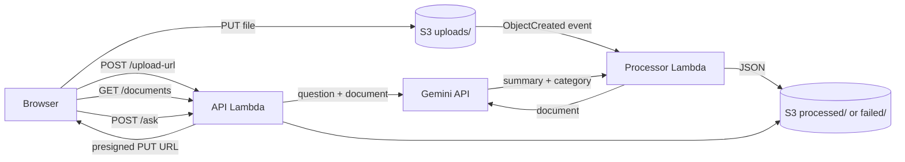

# DocFlow – AI-Powered Serverless Document Processing

Upload a document and get back an AI summary, category and keywords, then ask questions about it. Built on **Amazon S3**, **AWS Lambda**, **API Gateway** and the **Gemini API**, with no servers to manage.

## Architecture



## Features

- Direct browser-to-S3 uploads with short-lived presigned URLs (files never pass through Lambda)
- Event-driven processing triggered by S3 `ObjectCreated` events
- Gemini summarization and categorization (text, PDF and image input)
- Question bar: after a file is processed, ask questions and get answers based only on that document
- Failure handling: empty, oversized or unsupported files, Gemini errors, malformed AI output
- Retries with exponential backoff on Gemini 429/5xx responses
- Idempotent processing so duplicate S3 events do no extra work
- Private, encrypted bucket; least-privilege IAM through SAM policies
- API throttling to protect the Gemini key from abuse
- Clean futuristic website in `docs/` (works in demo mode without a backend)

## How it works

1. The page asks the API for a presigned URL and uploads the file straight to S3.
2. The upload triggers the processor Lambda, which sends the file to Gemini and saves a JSON result.
3. The page polls the API and shows the summary, category and keywords.
4. The question bar sends your question and the original file to Gemini and shows the answer.

## Project structure

```
template.yaml          AWS SAM infrastructure (S3, 2 Lambdas, HTTP API)
src/processor.py       S3-triggered Lambda: summary + category
src/api.py             Upload URLs, document list, questions
src/gemini_client.py   Shared Gemini client with retries
tests/                 Unit and API tests (in-memory S3 fake, no AWS needed)
docs/                  Website (GitHub Pages) and config.js for the API URL
scripts/personalize.py Fills in your GitHub username and name
```

## API

| Method | Route | Purpose |
|---|---|---|
| POST | `/upload-url` | Body `{"filename": "a.pdf"}`; returns a presigned PUT URL |
| POST | `/ask` | Body `{"id": "...", "question": "..."}`; returns `{"answer": "..."}` |
| GET | `/documents` | Pending and finished documents |
| GET | `/documents/{id}` | One result |

## Run the tests

```bash
pip install -r requirements-dev.txt
python -m unittest discover -s tests -v
```

## Deploy

Requires an AWS account, the AWS CLI, the SAM CLI and a Gemini API key from Google AI Studio.

```bash
sam build
sam deploy --guided --stack-name docflow --region ap-south-1
```

Copy the `ApiUrl` output into `docs/config.js` (`window.DOCFLOW_API = "..."`) and push. Use a lowercase stack name: it is part of the bucket name.

## Website

Enable GitHub Pages: Settings → Pages → Deploy from branch → `main` → `/docs`. Without an API URL the site runs in demo mode.

## Design decisions

- **Presigned URLs** avoid API Gateway's 10 MB payload limit and keep large files out of Lambda.
- **Results as JSON in S3** keeps the system simple and cheap. DynamoDB is the next step for querying.
- **Standard library HTTP client** means no Lambda layer or dependency packaging.
- **Failures are saved to `failed/`** instead of crashing, so users always get an answer.
- **Idempotent processor** because S3 can deliver the same event more than once.

## Testing

26 unit and API tests cover Gemini parsing, retries and backoff, empty, oversized and unsupported files, duplicate events, URL-encoded keys, input validation, path traversal and the question endpoint. An in-memory S3 fake lets them run without AWS, and GitHub Actions runs them on every push.

## Security and limits

- Bucket is private and encrypted; browsers only get short-lived presigned URLs.
- IAM permissions are scoped to this one bucket.
- The API is throttled to protect the Gemini key.
- The Gemini key is a Lambda environment variable; Secrets Manager would be the production choice.
- There is no user login, so documents are visible to anyone with the API URL. Add Cognito before real use.

## Roadmap

Secrets Manager, Cognito authentication, an SQS dead-letter queue, DynamoDB for metadata and search, and Textract for scanned documents.

## License

MIT
